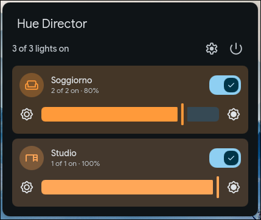

# Hue Director

Control your Philips Hue lights from the Dux Shell bar. Hue Director talks directly to your Hue Bridge on the local network (Hue API v2).

Works with Dux Shell >= 2.0.0 (formerly DankMaterialShell).



## Features

- **Bar pill**: lightbulb icon and number of lights on, for the whole home or a favorite room. Turns red when the bridge can't be reached. Right-click it to turn your favorite light on or off.
- **Room cards**: one card per room with its icon, how many lights are on, an on/off switch and a brightness slider. Cards are tinted with the current color of the room's lights. A button turns off every light in the home.
- **Room page**: click a card to open the room. Scenes are shown as tiles painted with the scene's own colors; the active scene is marked, scenes with a color palette have a play button to run them as dynamic scenes, and smart scenes (a different scene for each time of day) are marked with a clock. Each light has its own switch and brightness slider; unreachable lights (unplugged or out of range) are marked.
- **Identify**: a button on each light pulses its brightness twice in 2.5 seconds and then restores it, so you can tell which lamp it is.
- **Color**: click a light to show its color controls, including light effects (candle, fireplace, sparkle, ...) and a 30-minute sunrise or sunset: color temperature (in Kelvin), a rainbow hue slider, and the shell color picker for any exact color (hex, color area, eyedropper, recent colors). Sliders are tinted with the current color of the light.
- **Automations**: turn a light, a room or all lights on or off when you log in, lock or unlock the screen, the monitors turn off or on, suspend or resume, log out, power off or reboot. Set them up in the plugin settings (gear button in the popout).
- **Live updates**: changes made from the Hue app or switches show up right away, through the bridge event stream. If the stream fails, the plugin falls back to polling every 30 seconds.

The plugin talks only to your Hue Bridge. The only internet request is bridge discovery through `discovery.meethue.com`, and only when the bridge isn't found on the local network.

### Known limitations

- The hue slider sets fully saturated colors; use the color picker for pastel tones.
- Colors shown on screen are an approximation: Hue lamps can produce colors a monitor can't display.
- Only rooms are shown; zones are not supported yet.
- Hue Bridge v1 (the round first-generation bridge) is not supported: it has no API v2.

## Requirements

- `curl` and `openssl`
- A Philips Hue Bridge (second generation or Bridge Pro) on the same local network
- Optional: `avahi` (`avahi-browse`), to find the bridge on the local network without going through `discovery.meethue.com`

Automations also use `systemd-inhibit` and `systemd-run` (part of systemd).

The plugin checks for `curl` and `openssl` when it is enabled. If one is missing, the plugin is not activated and the shell shows what to do.

## Installation

1. Open DMS Settings → Plugins
2. Click "Scan for Plugins"
3. Browse for `Hue Director` 3rd party plugin
4. Install and enable it

Manual install: clone this repository into `~/.config/dms/plugins/hueDirector`, then scan for plugins and enable it.

## Pairing with the Hue Bridge

The plugin needs to be paired with your Hue Bridge once. Keep the bridge within reach: you will have 90 seconds to press its button.

### First time

1. Add the Hue Director widget to the bar. While it is not paired, it shows a broken-link icon.
2. Click the widget to open it, then click **Pair**.
3. When the widget asks you to, press the round button on top of the Hue Bridge.
4. The widget shows "Paired with the Hue Bridge" and loads your rooms.

### Pairing again

Pair again if you reset or replaced the bridge, or if its IP address changed:

1. Open DMS Settings → Plugins → Hue Director.
2. Under **Hue Bridge**, click **Pair again** and press the bridge button.

The current pairing is replaced only if the new one succeeds. If you cancel, or the button is not pressed in time, nothing changes.

### If the bridge is not found

The plugin looks for the bridge on your network automatically. If it can't find it, enter the bridge IP address in the **Bridge IP address** field before clicking Pair. The Hue app shows it under Settings → Bridges.

### Security and privacy

- The pairing key is stored in the Dux Shell state folder (`~/.local/state/dms/plugins/hueDirector/bridge.conf`, readable only by you). It is never passed on a command line.
- The bridge certificate is checked on every request: at pairing, the plugin remembers the bridge's public key and rejects any other device that answers on its address. If you replace the bridge, pair again.

## Automations

In Settings → Plugins → Hue Director → **System events**, pick for each event what to switch (nothing, all lights, a room or a light) and whether to turn it on or off.

| Event | How it is detected |
|---|---|
| Login | The shell starts within 2 minutes of the session start (restarting the shell later doesn't count) |
| Screen locked / unlocked | Dux Shell lock screen |
| Monitors off / on | Dux Shell power saving turning the monitors off (DPMS) and back on. Monitors turned off by other tools (e.g. hypridle) are not detected |
| Suspend or hibernate / Resume | Suspend started from Dux Shell (power menu, idle): when the shell requests it, while the network is still up. Other suspends (lid, terminal): logind sleep signal, which may be too late, since NetworkManager takes the network down at the same moment. The system waits up to 5 seconds (logind `InhibitDelayMaxSec`). On resume the rule retries for up to 30 seconds until the network is back |
| Power off / Reboot | logind shutdown signal, with the same wait. Power off and reboot are told apart on systemd 256 or newer; on older systems the Power off rule runs for both |
| Logout | A small user service bound to `graphical-session.target` runs the action when the session ends. It needs a systemd-managed session (e.g. uwsm); otherwise logout rules don't run |

## Settings

- **Hue Bridge**: shows the paired bridge and lets you pair again.
- **Favorite room**: room shown in the bar pill (icon and number of lights on). Default: all rooms.
- **Fade time**: how long lights take to turn on or off and to change scene: the bridge default (0.4 s), instant, 1, 2 or 4 seconds. Brightness and color sliders are not faded.
- **Dynamic scene speed**: how fast colors cycle when you play a dynamic scene. The speed is saved in the scene on the bridge, so the Hue app uses it too.
- **Show lights on count**: number next to the bar icon. Turn it off to keep only the icon, which still changes with the lights' state. Default: on.
- **Favorite light**: a light, a room or all lights. Right-click the bar icon to turn it on or off.
- **System events**: the automations described above.

## Command line and keybindings

The plugin answers `dms ipc` calls, so you can bind lights to keys:

| Command | Effect |
|---|---|
| `dms ipc call hueDirector toggle` | Toggles the favorite light (Settings → Favorite light) |
| `dms ipc call hueDirector on <target>` | Turns on `all`, a room or a light, by name |
| `dms ipc call hueDirector off <target>` | Turns it off |
| `dms ipc call hueDirector scene <name>` | Activates a scene; use `Room/Scene` when several rooms have a scene with that name |

Names are case-insensitive; quote names with spaces. Example for Hyprland:

```
bind = SUPER, L, exec, dms ipc call hueDirector toggle
bind = SUPER SHIFT, L, exec, dms ipc call hueDirector scene "Studio/Relax"
```

Each call answers `ok`, or says what is wrong (e.g. `no scene named Relax`, `not paired`).

## Uninstall

1. Open Settings → Plugins → Hue Director and click **Forget bridge** twice. This removes the pairing key, the logout action and the `hue-director-session` user service from this computer.
2. Disable and uninstall the plugin in Settings → Plugins.

If the plugin is already gone, remove the leftovers by hand:

```sh
rm -f ~/.local/state/dms/plugins/hueDirector/logout.action
systemctl --user stop hue-director-session
rm -rf ~/.local/state/dms/plugins/hueDirector
```

Remove `logout.action` before stopping the service: stopping it runs the logout action.

The bridge may still list Hue Director among its connected apps.

## Translations

The interface is in English and follows the Dux Shell language (Settings → Locale). Available translations: French, German, Italian, Japanese, Korean, Simplified Chinese and Spanish (`translations/`). They were machine-assisted: corrections from native speakers are welcome.

To add a language, copy `translations/it.json` to `translations/<locale>.json` (e.g. `de.json`, `pt_BR.json`) and translate the values. Each key is the English text; placeholders like `%1` must stay in the translation. Missing terms fall back to English. Reload with `dms ipc call plugins reload hueDirector`.

Room, light and scene names come from your Hue Bridge and are shown as they are.

## License

MIT
